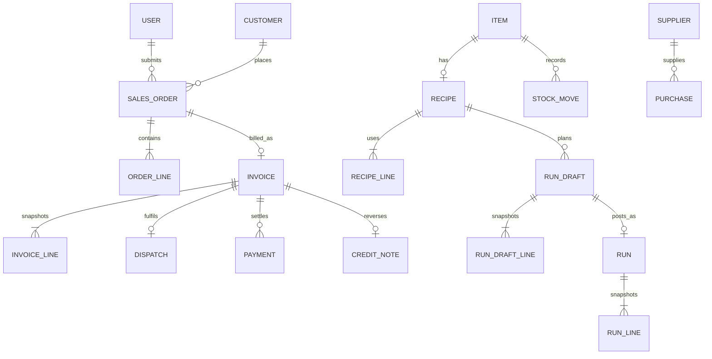

# Batchbook design note

The application models a single factory with one physical stock location. A Flask request starts with a role check and hands off a write to a plain Python function. SQLite persists both the business document and its stock consequences in the same transaction.

### Stock and posting

Physical stock is the sum of signed movements for an item. The item ledger links to its purchase receipt, batch, or invoice. Stock counts retain the reason and actor alongside the adjustment. Approval reserves finished packets and dispatch takes them out of physical stock. A credit note releases the reservation for an unpaid, undispatched invoice. Movements are append-only.

SQLite acquires the write lock before the availability check so two approvals cannot allocate the same packets. Posting a batch rechecks materials and commits the stock movements with the run. A failed post leaves the saved draft available. The draft can link to one posted run. Orders use a client reference to avoid duplicate submissions.

### BOM and variance

A recipe defines material and packaging per batch, expected packets and tolerance. Starting a batch saves a copy of that plan and the raw quantities entered. Posting adds the packaging and yield. Variance compares the total used plus waste with the saved plan. For 10 L planned and 10.5 L used the variance is +5%. For 200 expected and 188 good packets it is −6%. A flag requires a variance strictly outside the tolerance. Storage units are whole pieces, grams or millilitres. A carton converts to its product’s configured packet count.

Production planning reads submitted packets and available stock from one database snapshot. Suggested batches equal the shortage divided by expected yield, rounded up. The material check adds the BOM requirement for each suggested batch across all products.

### Valuation and accounts

Each stock movement carries a value in integer paise. A receipt adds quantity and purchase value. For an issue, the current ledger value divided by quantity gives a moving weighted average. The issue value rounds once to the nearest paise. This uses blended costs without tracking purchase lots. The production run transfers material cost into finished stock, then adds labour and energy directly to that run for the cost-per-good-packet comparison. Units and stock value use consistent integer arithmetic.

An invoice snapshots customer, description, HSN, price and tax. The financial-year sequence uses April to March. Local CGST and SGST are rounded per line, and interstate lines show IGST. Payments are separately posted against the invoice and ageing uses outstanding value as of the selected report end date. Audit events include actor and timestamp, and run overhead edits retain previous and new figures in the log.
