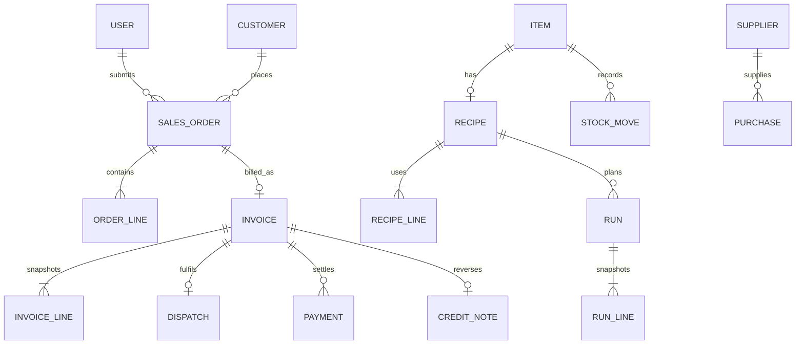

# Batchbook design note

The application models a single factory with one physical stock location. A Flask request starts with a role check and hands off a write to a plain Python function. SQLite persists both the business document and its stock consequences in the same transaction.

### Stock and posting

Physical stock is the sum of signed movements for an item. Receipt, production, dispatch and count adjustments create movements that point to their source document. A date-range ledger gets its running balance from all prior movements. Approval reserves finished packets by counting approved and invoiced orders. Dispatch is the step that physically takes stock out. A credit note releases the reservation when the invoice is unpaid and undispatched. No stock movement is edited or deleted.

SQLite uses an immediate write transaction for the availability check and write so two approvals cannot allocate the same packets. A production run adds its good packets and all material issues, or rolls back the whole transaction. Invoice and dispatch documents are unique per order and invoice. Field orders and browser production posts carry a submission key so a retry keeps one transaction.

### BOM and variance

A recipe defines material and packaging quantity per batch, expected packets and tolerance. Posting snapshots the scaled plan and records actual used and wasted quantity per component. A planned 10 L and actual 10.5 L gives +5%. A planned 200 and actual 188 packets gives −6%. Absolute variance must exceed the tolerance to flag. The plan is rounded to the nearest stored unit. Counts use whole units, mass uses grams, and volume uses millilitres. Pack-to-carton conversion uses each product’s carton size.

### Valuation and accounts

Each stock movement carries a value in integer paise. A receipt adds quantity and purchase value. For an issue, the current ledger value divided by quantity gives a moving weighted average. The issue value rounds once to the nearest paise. This uses blended costs without tracking purchase lots. The production run transfers material cost into finished stock, then adds labour and energy directly to that run for the cost-per-good-packet comparison. Units and stock value use consistent integer arithmetic.

An invoice snapshots customer, description, HSN, price and tax. The financial-year sequence uses April to March. Local CGST and SGST are rounded per line, and interstate lines show IGST. Payments are separately posted against the invoice and ageing uses outstanding value as of the selected report end date. Audit events include actor and timestamp, and run overhead edits retain previous and new figures in the log.
